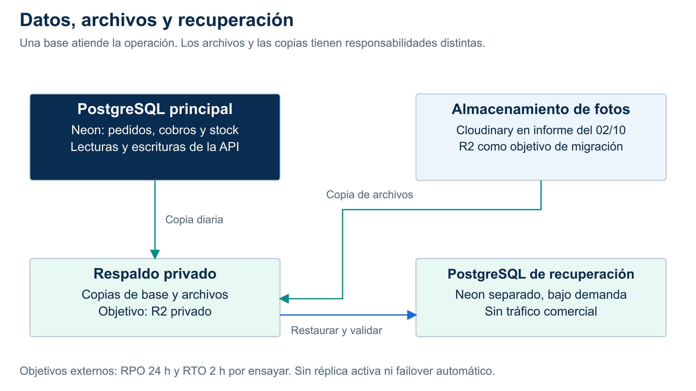

# Datos, archivos y recuperación

| Recurso | Qué conserva | Cómo participa | Estado |
|---|---|---|---|
| PostgreSQL principal, Neon | Negocios, usuarios, carta, pedidos, cobros, stock y reportes derivados. | La API lee/escribe mediante repositorios y transacciones. | Persistencia documentada; aceptación integral pendiente. |
| Almacenamiento de fotos | Bytes de imágenes y archivos; la DB conserva sus referencias. | Entrega por URL/CDN. No ejecuta consultas ni transacciones de ventas. | Cloudinary en el informe del 02/10/2026; R2 como objetivo. |
| Respaldo privado | Copias de base y archivos, con fecha, integridad y permisos privados. | Se usa para recuperar; no sirve como catálogo público. | Objetivo con credenciales y bucket separados. |
| PostgreSQL de recuperación, Neon | Datos restaurados, roles, políticas y referencias de una copia. | Entorno aislado bajo demanda para simulacros/restauración. | Objetivo; sin tráfico comercial, réplica activa ni failover automático. |

**Respuesta a “¿por qué dos bases?”:** una atiende la operación; la otra permite comprobar una restauración sin tocar la principal. No se reparten pedidos y fotos entre dos bases SQL: las fotos son objetos. Tampoco se balancea tráfico entre ambas bases.

Propuesta de respaldo: copia diaria; siete diarias y cuatro semanales; ensayo semanal. RPO externo de 24 h y RTO de 2 h son metas por medir. Una copia no probada no demuestra recuperación. PITR y copia externa cumplen funciones complementarias.

[SVG](../../img/fuentes-svg/almacenamiento-y-recuperacion.svg) · [PDF](../../img/almacenamiento-y-recuperacion.pdf) · [Fallos](manejo-de-fallos.md).
