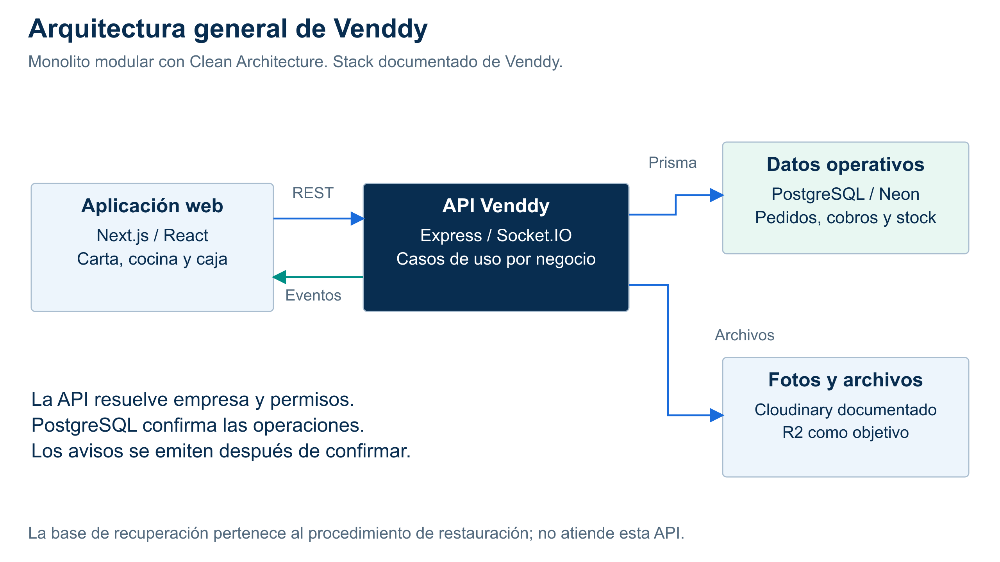

# Arquitectura general de Venddy

**Estilo:** monolito modular. **Enfoque:** Clean Architecture. Esta es la única propuesta activa del primer sprint.

| Elemento | Función |
|---|---|
| Next.js / React | Carta QR y pantallas de cocina, caja y administración. |
| API Express / Socket.IO | Autorización, casos de uso y comunicación por negocio. |
| Prisma / PostgreSQL en Neon | Persistencia y transacciones de pedidos, cobros y stock. |
| Almacenamiento de objetos | Fotos y archivos; Cloudinary en el informe del 02/10/2026 y R2 como objetivo de migración. |

La API confirma las operaciones antes de avisar. Al reconectar se recupera el estado por REST. Las credenciales de datos y servicios permanecen en el servidor.

[Fuentes SVG](../../img/fuentes-svg/diagrama-arquitectura.svg) · [PDF](../../img/diagrama-arquitectura.pdf) · [Módulos](componentes-arquitectonicos.md) · [Datos, archivos y recuperación](almacenamiento-y-recuperacion.md).

El stack procede del informe de Venddy. Este repositorio documenta la solución y contiene una demostración académica; no equivale a inspeccionar el despliegue actual. No fija capacidad ni disponibilidad sin ensayo.
