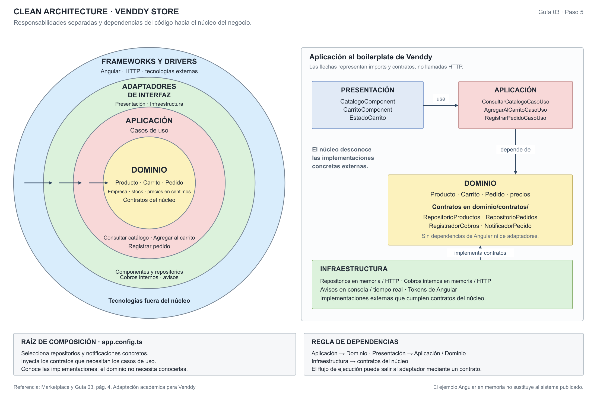

# Enfoque único: Clean Architecture

Se conserva el original de círculos concéntricos y su panel de aplicación a Venddy. Los círculos describen el nivel de las reglas y mecanismos; el panel relaciona esa representación con las cuatro carpetas del ejemplo. No existe una correspondencia obligatoria de un círculo con una carpeta. La raíz de composición queda fuera del núcleo.

| Responsabilidad | Venddy | Dependencia permitida |
|---|---|---|
| Dominio | Producto, Carrito, Pedido, importes, stock, estados y contratos. | Elementos del propio núcleo. |
| Aplicación | Consultar carta, agregar al carrito y registrar pedido; coordinación de operaciones. | Dominio y sus contratos. |
| Presentación | Carta y carrito; en el backend propuesto, controladores y entradas autorizadas. | Aplicación y tipos del núcleo. |
| Infraestructura | Repositorios, transacciones y adaptadores de avisos, archivos y cobros. | Contratos del núcleo que implementa. |

Dominio y Aplicación no importan Angular, Express, Prisma ni SDK de proveedores. La raíz de composición conecta implementaciones; no pertenece al dominio.

En el ejemplo, los contratos están en `dominio/contratos/`. El caso de uso recibe `RepositorioPedidos` y `NotificadorPedido`; las implementaciones en memoria/consola se eligen en `app.config.ts`. Prisma/PostgreSQL y Socket.IO corresponden al diseño del sistema, no a una conexión activa de la demostración.

ADR-002 responde a DA04 y AC05. El estilo monolito modular define cómo se organiza/despliega el backend; Clean define sus responsabilidades y dependencias.

[SVG](../../arquitectura/enfoque/diagrama-enfoque-arquitectonico.svg) · [PDF](../../arquitectura/enfoque/diagrama-enfoque-arquitectonico.pdf) · [Diseño de Pedidos](../03-diseño-de-software/diseño-interno/diseño-interno-de-modulos.md).
