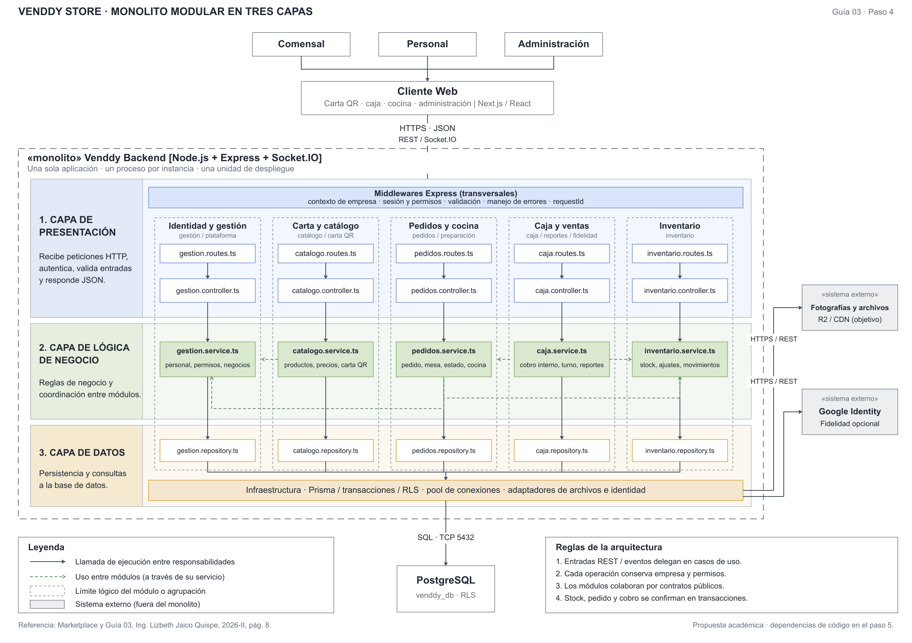

# Estilo: monolito modular

Se conserva el gráfico original. Las cinco columnas agrupan ocho módulos: Identidad y gestión reúne Administración y Plataforma; Caja y ventas agrupa también Reportes y Fidelidad. Las otras columnas son Catálogo, Pedidos/cocina e Inventario.

Sus tres responsabilidades globales son Presentación, Negocio y Datos. Negocio agrupa Aplicación y Dominio; Datos corresponde a los mecanismos de Infraestructura. Las flechas de esta vista muestran ejecución. Las dependencias del código se precisan en la vista Clean; no se introduce otro enfoque.

| Decisión | Consecuencia en Venddy |
|---|---|
| Una API desplegable | Los módulos se ejecutan juntos; no son ocho servidores. |
| Ocho módulos | Catálogo, Pedidos/cocina, Caja/ventas, Inventario, Administración, Plataforma, Fidelidad y Reportes. |
| Límites internos | Colaboración por servicios/contratos públicos; repositorios protegidos por módulo. |
| Coordinación consistente | Confirmar pedido/stock/cobro según su transacción antes de emitir eventos. |

ADR-001 responde a DA04 y DA06: separar responsabilidades con una operación sencilla. Microservicios exigirían justificar despliegues independientes y coordinación distribuida. Ante la caída del proceso de API, todos sus módulos pierden servicio; el monolito no promete aislamiento físico ni alta disponibilidad.

Clean Architecture organiza cada módulo en cuatro responsabilidades; la vista de web/API/datos describe contenedores, no un enfoque alternativo.

[SVG](../../arquitectura/diagrama-estilo-arquitectonico.svg) · [PDF](../../arquitectura/diagrama-estilo-arquitectonico.pdf) · [ADR](../01-analisis-de-sistema/07-decisiones-arquitectonicas.md).
