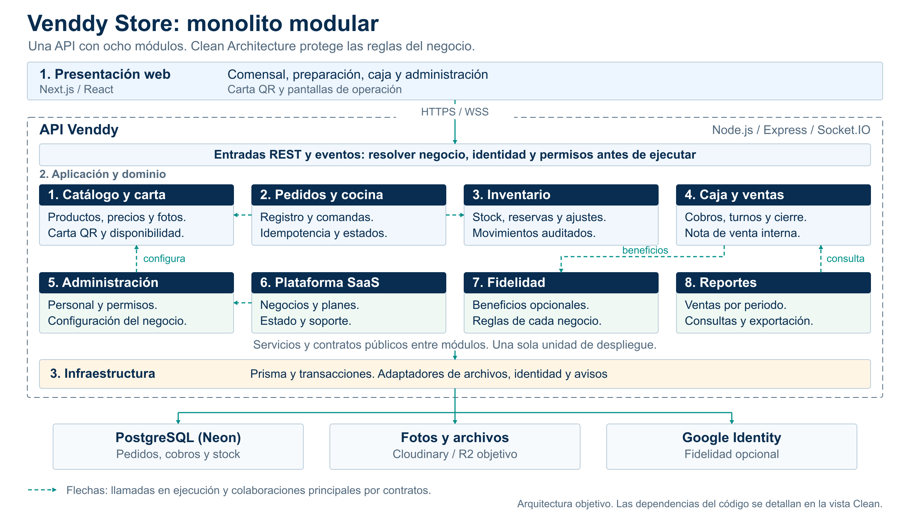

# Estilo: monolito modular

Los ocho módulos aparecen separados y numerados dentro del límite de una sola API. Cada bloque muestra una responsabilidad; las flechas destacan colaboraciones por contratos públicos.

La vista se lee desde Presentación web hacia Aplicación/Dominio e Infraestructura. PostgreSQL, archivos e identidad externa están fuera del proceso de API. Las flechas muestran llamadas durante la ejecución; las dependencias del código se precisan en la vista Clean.

| Decisión | Consecuencia en Venddy |
|---|---|
| Una API desplegable | Los módulos se ejecutan juntos; no son ocho servidores. |
| Ocho módulos | Catálogo, Pedidos/cocina, Caja/ventas, Inventario, Administración, Plataforma, Fidelidad y Reportes. |
| Límites internos | Colaboración por servicios/contratos públicos; repositorios protegidos por módulo. |
| Coordinación consistente | Confirmar pedido/stock/cobro según su transacción antes de emitir eventos. |

ADR-001 responde a DA04 y DA06: separar responsabilidades con una operación sencilla. Microservicios exigirían justificar despliegues independientes y coordinación distribuida. Ante la caída del proceso de API, todos sus módulos pierden servicio; el monolito no promete aislamiento físico ni alta disponibilidad.

Clean Architecture organiza cada módulo en cuatro responsabilidades; la vista de web/API/datos describe contenedores, no un enfoque alternativo.

[SVG](../../img/fuentes-svg/ArquitecturaMonoliticaVenddyEnCapas.svg) · [ADR](../01-analisis-de-sistema/07-decisiones-arquitectonicas.md).
