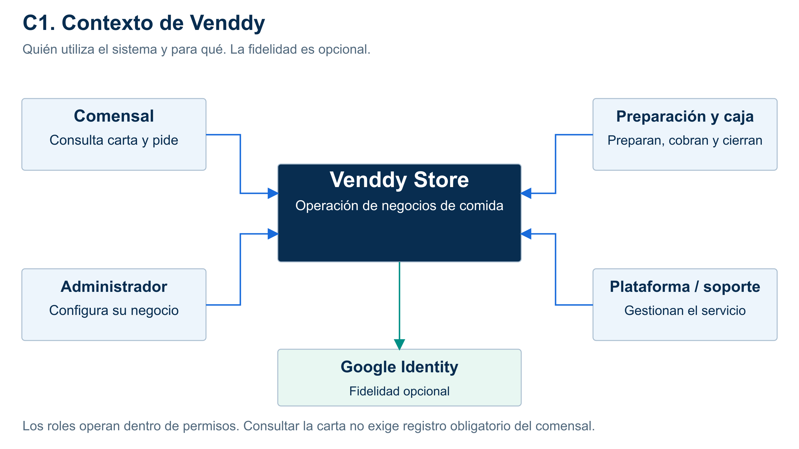

# C1: contexto

**Alcance:** Venddy, comensal, preparación, caja, administrador, plataforma/soporte y la identificación opcional de fidelidad.

Permite explicar quién usa el sistema y su propósito, sin abrir sus módulos.

[SVG](../../img/fuentes-svg/nivel1-contexto.svg) · [PDF](../../img/nivel1-contexto.pdf).

Modelo: [C4 oficial](https://c4model.com/diagrams). Las vistas comunican la misma propuesta Clean Architecture a distintos niveles de detalle.
