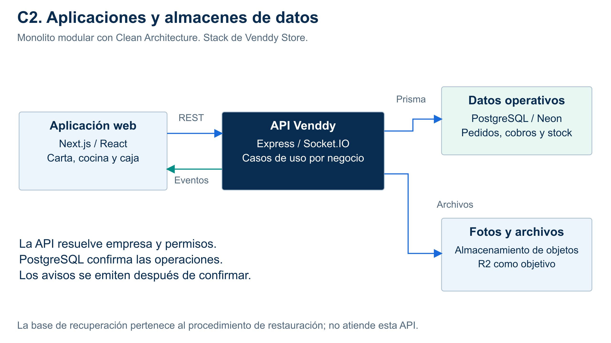

# C2: contenedores

**Alcance:** Web Next.js/React, API Express/Socket.IO, PostgreSQL principal y almacenamiento de fotos.

Web/API se comunican por HTTPS/REST y eventos; la API accede a datos. Prisma es una biblioteca de acceso, no un contenedor independiente.

[SVG](../../img/fuentes-svg/nivel2-contenedores.svg).

La base de recuperación no recibe tráfico de esta API: pertenece al procedimiento de restauración. [Datos y archivos](../02-arquitectura-software/arquitectura-inicial.md#datos-y-recuperación).

Modelo: [C4 oficial](https://c4model.com/diagrams). Las vistas comunican la misma propuesta Clean Architecture a distintos niveles de detalle.
