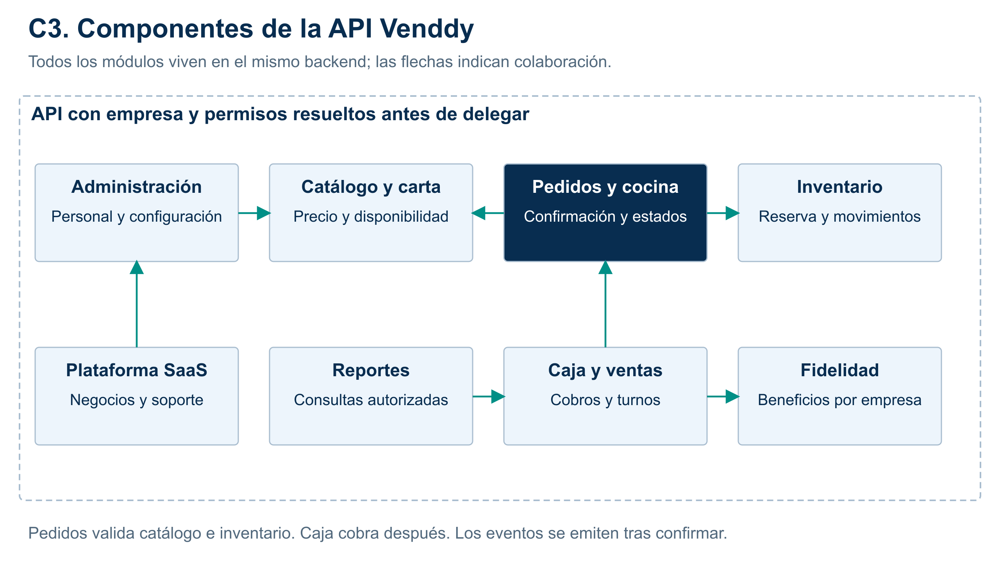

# C3: componentes de la API

**Alcance:** Entrada autorizada y ocho módulos en el mismo backend.

Pedidos consulta Catálogo y coordina Inventario; Caja registra cobros y colabora con Fidelidad. Reportes utiliza consultas autorizadas. No son ocho microservicios.

[SVG](../../img/fuentes-svg/nivel3-componentes.svg) · [PDF](../../img/nivel3-componentes.pdf).

Modelo: [C4 oficial](https://c4model.com/diagrams). Las vistas comunican la misma propuesta Clean Architecture a distintos niveles de detalle.
