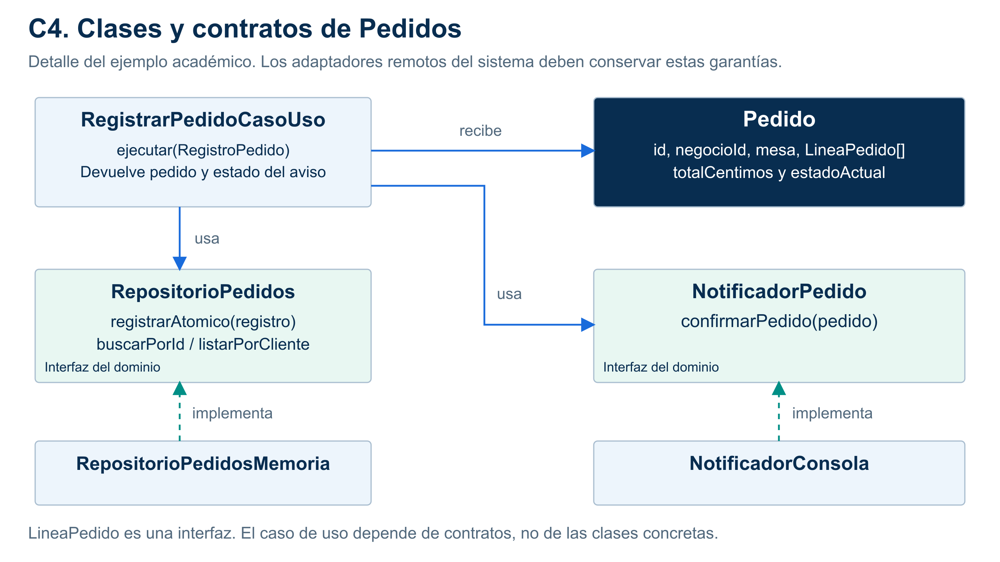
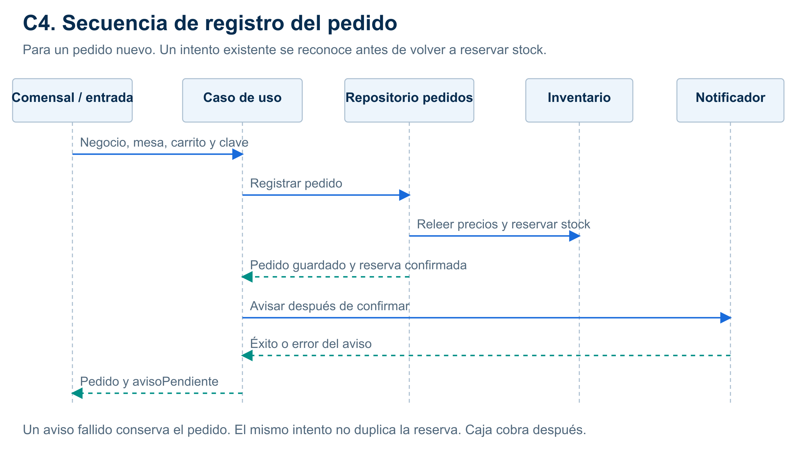

# C4: detalle de Pedidos

**Alcance:** Clases, interfaces y colaboraciones del núcleo de Pedidos.

Usa los nombres reales del ejemplo y distingue entidad, interfaz y adaptador. Un diseño PostgreSQL futuro debe conservar el contrato demostrado en memoria.

[SVG](../../img/fuentes-svg/nivel4-clases.svg) · [PDF](../../img/nivel4-clases.pdf).

La misma clave y contenido recupera el pedido anterior antes de volver a validar existencias. Un pedido nuevo valida, reserva y guarda; después avisa. El fallo de notificación conserva el pedido.

[Fuente de la secuencia](../../img/fuentes-svg/nivel4-secuencia.svg) · [Diseño interno](../03-diseño-de-software/diseño-interno/diseño-interno-de-modulos.md).

Modelo: [C4 oficial](https://c4model.com/diagrams). Las vistas comunican la misma propuesta Clean Architecture a distintos niveles de detalle.
